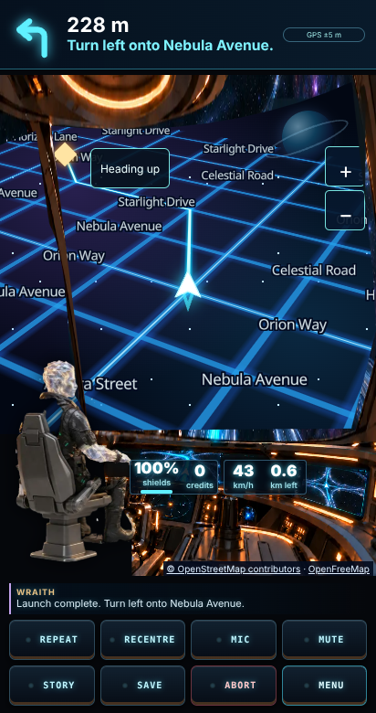
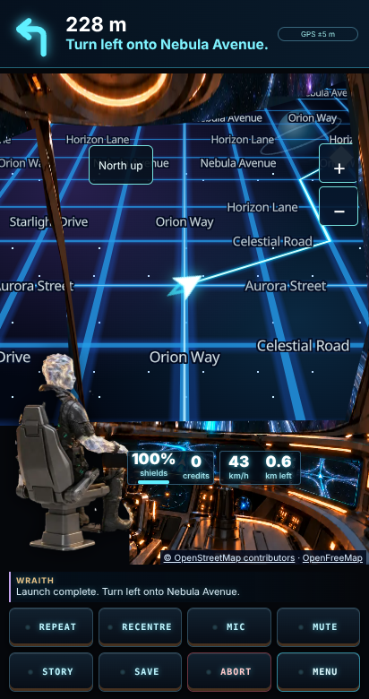

# Windscreen map preview

Branch: `codex/windscreen-map`, based on `build/mole-beyond-1.0.20` at `20fbf6fa635c141aa6a5ba85d5aa241f0e2fb36b`.

The screenshots use deterministic **simulated roads, GPS and route data**, not a real journey. They run the generated game and injected cockpit artwork in Chromium with real MapLibre WebGL rendering. The selected captain is the light-being explorer; the existing 24-captain selection remains intact.

| Heading up, 412×780 | North up, 412×780 |
| --- | --- |
|  |  |

[S23 Ultra-sized north-up preview, 412×915](s23-north-up.png)

## Implementation

- `src/navLayoutPatch.ts`: SVG alpha mask clears the windscreen and baked captain from the existing cockpit art. Two aligned art sections extend the glass for portrait while keeping the console compact. The selected two-layer seated captain stays on the left. Live speed/distance use the console screen's image coordinates. The old CSS perspective, map rotation, raster filters and GPS interception are removed. Parked artwork and microphone/story behavior are unchanged.
- `mole-beyond-hybrid-03/src/lib/foundation/cosmic-navigation.js`: MapLibre renderer and custom OpenFreeMap vector style. Blue road glow, cyan route stream, white heading-aware ship, upright high-contrast labels, 57° camera pitch, destination marker, remembered orientation, follow/pan/recenter behavior. Consumes existing snapshots; no routing, GPS subscription or guidance changes.
- `live-navigation.js` and `simulator.css`: integrate the vector presentation only in navigation, retain Leaflet for parked planning and as a flat fallback when WebGL cannot start, expose zoom controls and visible OpenStreetMap/OpenFreeMap attribution. Display tile/network errors. No API keys.
- `package.json` / lock: pinned MapLibre dependency and development-only screenshot tools.
- `src/hybridHtml.ts`: generated with the repository bundler; never edited by hand.
- Tests cover route coordinate conversion, heading/north mode, remembered orientation, panning/recenter, invalid GPS snapshots, cleanup, attribution and the real MapLibre style validator. Existing game tests remain enabled.

## Verification

- `npm test`: **116 passed** (41 app tests + 75 game tests).
- `npm run typecheck`: passed.
- `node scripts/bundle-hybrid.mjs --check`: included in tests; generated document **2,927,251 bytes / 2.79 MiB**, below the enforced 4 MiB budget.
- `node scripts/capture-windscreen.cjs`: passed, real WebGL style/labels, heading 60° / north 0°, visible controls/attribution, tray expansion, orientation after pan, Recenter and zoom buttons. No page errors. Checks both 412×780 and 412×915.

Reproduce with Node 24, `npm ci`, `node scripts/bundle-hybrid.mjs`, then the checks above. The screenshot script uses installed Chromium at `/usr/bin/chromium`; set `CHROMIUM_PATH` to another local Chromium executable if needed. Screenshot fixtures intercept map/routing traffic, so screenshot generation does not contact tile services. The Noto Sans glyph fixture is from MapLibre demotiles commit `601ae60796ceceda2cbd2ed3d2ea92d17a84be4b`, `font/Noto Sans Regular/0-255.pbf`; its SIL OFL license is alongside the fixture.

## Still needs Android verification

The cloud proxy denies `tiles.openfreemap.org` (including the elevated connectivity retry). Production tile metadata, vector roads and glyphs therefore **have not been verified against the live OpenFreeMap service here**. The fixture uses the OpenMapTiles transportation/transportation_name schema expected from that service.

On the S23 Ultra check live tile/glyph loading over Wi-Fi and mobile data, real place/street coverage, heading stability and marker tracking, touch gestures/zoom/Recenter, resume after screen-off/backgrounding, WebGL performance/heat, offline/error recovery and flat fallback, frame/readout fit with Android font/display scaling, and parked-to-navigation transitions. No physical-device test or new APK build is claimed for this branch.

Routing, guidance, GPS/native bridge, voice and story/dialogue files are untouched. No merge into the parallel 1.0.20 branch was performed.
